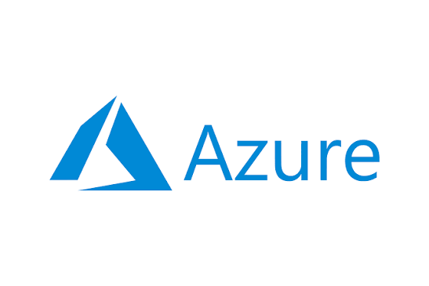
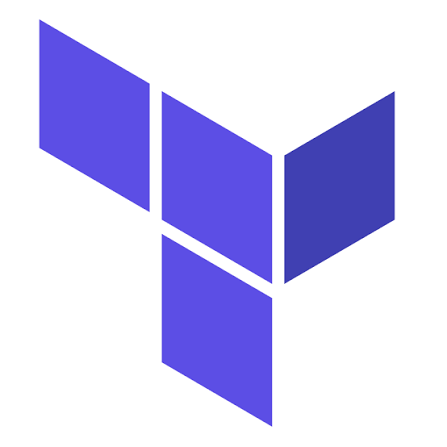

<table align="center">
  <tr>
    <td align="center"></td>
    <td align="center"></td>
    <td align="center"></td>
  </tr>
  <tr>
    <td align="center"><b>Azure</b></td>
    <td align="center"><b>Terraform</b></td>
    <td align="center"><b>Git</b></td>
  </tr>
</table>


# azure-infra-gitops

A GitOps-style Azure infrastructure automation platform using Terraform, GitHub Actions, OIDC authentication, policy enforcement, and drift detection. 


# motivation to build this project


In my previous organization infrastructure was bit messy and used to confuse everyone a lot, since it was never automated
in proper way.

1. First there was **no record**, Nobody knew who changed what, when or why. A person X changed some configuration in Azure without person Y knowing it who was responsible for it !!

2. **No Review**, any vulnerable change goes live in prod before other engineers reviewing it

3. Some **manual changes** are always hidden. The point is, if a minor change is made in Azure, then the other team members cannot know it. That's the other issue. 

4. **Rolling back** is quite difficult when we don't know what we have clicked and what all configurations we have set. 

5. A lot of times, service credentials are shared via Slack, Gmail, or Microsoft Teams chat, which makes the entire credentials vulnerable. Then we need to take care of rolling it back, or we need to change the keys periodically by rotating them. That's another issue. 


### Without Scenario

We can imagine one scenario like this. Suppose there is one engineer named Vivek, and he opens the Azure portal, goes inside the Azure storage account, which was previously set to public. Now, what he does is change the blob access to public. He will definitely do a few clicks, and he changes the configuration from private to public. Now he forgets to turn it off.

The thing is, nobody reviewed what happened and recorded it in the team. The prod configurations are completely different from what the team believes they are. Now suppose after one month, the security audit team finds that the entire customer data is public and it can be read. The point is, nobody can see who changed it or when it was changed.

Again, the fix can only be done manually, so another team member is coming in, and now he is changing the configuration from public to private. This way, nobody knows who went inside, who clicked, and then who went out. This is the entire scenario without this. 


### With Scenario


One benefit is that, suppose your team lead says that we need a specific staging environment by Friday. Previously, the engineer needed to configure everything in parallel from prod to staging. Now, we have variables like prod.tfvars, which we definitely have, so that can be copied into staging.tfvars. The only thing we need to change is the IP range, and we need to open a PR. This environment is completely built from the same code, which is properly reviewed and identical in shape to what we are using in production 


## Definitions and links to resources 


## How it works

1. A developer changes Terraform in `terraform/` and opens a pull request.
2. The PR pipeline runs `terraform fmt`, `validate`, a Checkov security scan, and a `terraform plan` for dev and prod. The plan appears in the job summary.
3. After review and merge to `main`, dev deploys automatically.
4. Prod waits for a reviewer to approve the `prod` GitHub Environment, then deploys.
5. A daily workflow runs `terraform plan` against both environments. If Azure differs from the code, the run fails and GitHub emails the repo owner.
6. To revert a change, use `git revert <sha>` on a branch and open a PR. It goes through the same checks and approvals.

Authentication uses GitHub OIDC to a Microsoft Entra ID app registration. There are no stored Azure secrets.

## What gets deployed (per environment)

Resource group, storage account (HTTPS only, no public blob access, TLS 1.2), and a virtual network with one subnet. Azure Policy assignments enforce allowed regions, HTTPS-only storage, no public blob access, and a required `environment` tag.

## Setup

1. `az login`, then `GITHUB_ORG=<you> ./scripts/bootstrap.sh`
2. Run the `gh variable set ...` commands it prints.
3. Create GitHub Environments `dev` (no rules) and `prod` (required reviewers).
4. Protect `main`: require a PR and require the `checks` status check.

## Teardown

`terraform destroy -var-file=environments/<env>.tfvars` for each environment, then delete the `rg-gitops-tfstate` resource group and the `sp-gitops-github-actions` app registration.


### Easy Peasy Commands


```bash
az login
GITHUB_ORG=<your-github-username> ./scripts/bootstrap.sh
```

For deleting everything, run below command

```bash
./scripts/teardown.sh
```
